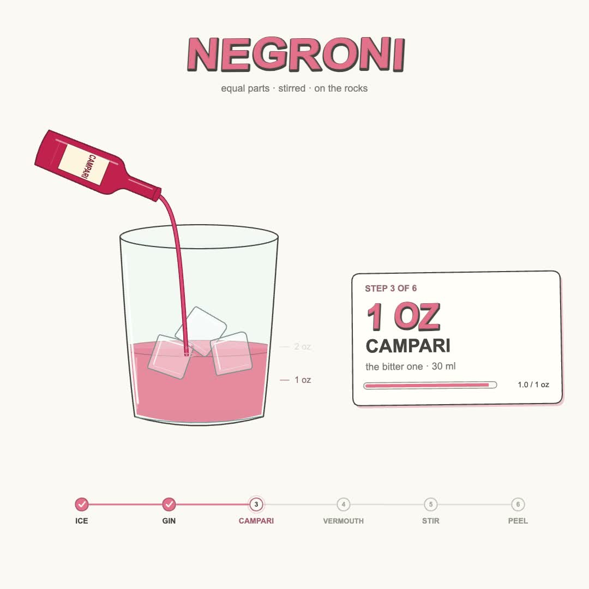
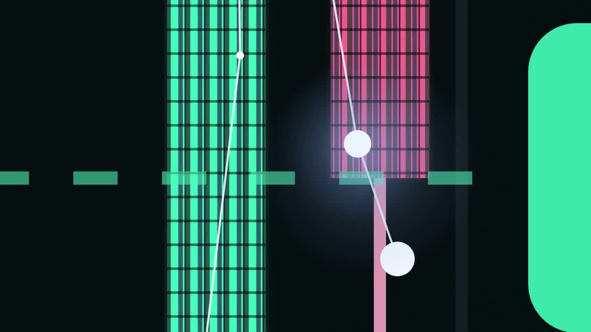
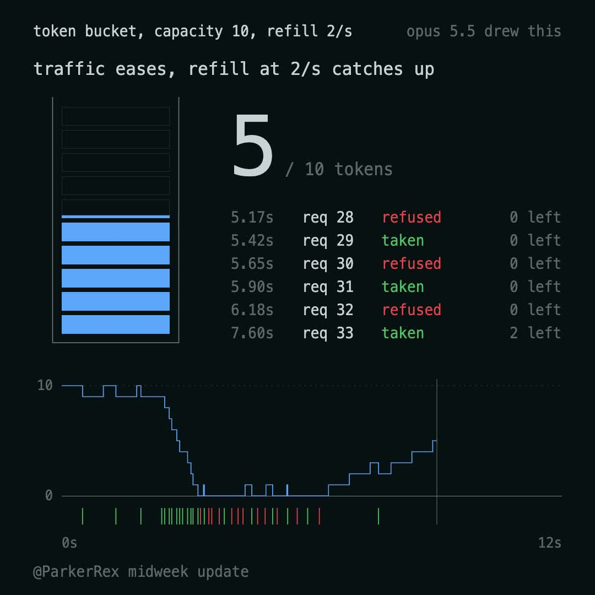

# Awesome GPT Videos

A GPT-6.1 Sol / **high reasoning** adaptation and reproduction lab inspired by [yihui-dev/awesome-opus5-5-videos](https://github.com/yihui-dev/awesome-opus5-5-videos). Original creator prompts, attribution and source metadata remain intact. GPT adaptations and measured results are kept separately.

**This is work in progress. The 703 prompts have been inventoried and adapted as drafts; they have not all been generated, rendered or visually validated.** Never interpret a draft prompt or a linked upstream remake as a successful GPT test.

<!-- COMPARISONS:START -->
## Comparisons and progress

**Priority: adapted recreations with GPT-6.1 Sol / high.** 8 adapted recreations rendered; 34 original-prompt baselines rendered. 9 entries have sampled review notes; 0 have a full review recorded.

References, extra inputs, supplied assets and revisions are disclosed. Sampled reviews do not establish visual parity or a model ranking. The [live comparison gallery](https://valekar.github.io/awesome-gpt-videos/) contains both tracks and their current evidence.

### Adapted recreations

| Case | Original creator output | GPT-6.1/high recreation | Recorded differences |
| --- | --- | --- | --- |
| Ror_Fly · ror-fly-880547<br>[Adapted prompt](prompts/gpt-6.1-high/ror-fly-880547.md) · [timed brief](comparison/matched-briefs/ror-fly-880547.md) | [](https://media.skillry.dev/opus-5-5/ror-fly-880547/original.mp4) | [](https://valekar.github.io/awesome-gpt-videos/#ror-fly-880547)<br>2 recorded attempt(s) · [Review](comparison/reviews/ror-fly-880547.json) | Bangers/Caveat differ from the original unknown typography; heading slant, glyph shapes and fine spacing remain different. |
| viktoroddy · viktoroddy-402509<br>[Adapted prompt](prompts/gpt-6.1-high/viktoroddy-402509.md) · [timed brief](comparison/matched-briefs/viktoroddy-402509.md) | [](https://media.skillry.dev/opus-5-5/viktoroddy-402509/original.mp4) | [](https://valekar.github.io/awesome-gpt-videos/#viktoroddy-402509)<br>1 recorded attempt(s) · [Review](comparison/reviews/viktoroddy-402509.json) | The full-resolution opening pair shows a substantially different collage crop and card arrangement. ORIGINAL centers the robot-headed person and blue-tree page, with Mars and a crowned winged figure at left; GPT centers Anchor AI and Agent Wave, with the robot card cropped at the top. The tilted, edge-filling grid mechanism is retained. |
| alex_prompter · alex-prompter-997524<br>[Adapted prompt](prompts/gpt-6.1-high/alex-prompter-997524.md) · [timed brief](comparison/matched-briefs/alex-prompter-997524.md) | [](https://media.skillry.dev/opus-5-5/alex-prompter-997524/original.mp4) | [](https://valekar.github.io/awesome-gpt-videos/#alex-prompter-997524)<br>1 recorded attempt(s) · [Review](comparison/reviews/alex-prompter-997524.json) | The completed composer paragraph wraps into six lines in GPT versus seven in ORIGINAL. GPT fits more words per line and ends the paragraph higher within the otherwise closely matched composer. |
| dale_vaz · dale-vaz-879074<br>[Adapted prompt](prompts/gpt-6.1-high/dale-vaz-879074.md) · [timed brief](comparison/matched-briefs/dale-vaz-879074.md) | [](https://media.skillry.dev/opus-5-5/dale-vaz-879074/original.mp4) | [](https://valekar.github.io/awesome-gpt-videos/#dale-vaz-879074)<br>2 recorded attempt(s) · [Review](comparison/reviews/dale-vaz-879074.json) | The original has a visible circular ring around the central light at 2–3s; GPT retains mostly a small glow. At 4s, GPT's horizontal line is also appreciably dimmer. |
| MajorBaguette · majorbaguette-834228<br>[Adapted prompt](prompts/gpt-6.1-high/majorbaguette-834228.md) · [timed brief](comparison/matched-briefs/majorbaguette-834228.md) | [](https://media.skillry.dev/opus-5-5/majorbaguette-834228/original.mp4) | [](https://valekar.github.io/awesome-gpt-videos/#majorbaguette-834228)<br>2 recorded attempt(s) · [Review](comparison/reviews/majorbaguette-834228.json) | The GPT background appears slightly darker and greener, with a less distinct central olive glow. This tonal difference recurs across the sampled scenes. |
| souravbhar871 · souravbhar871-477361<br>[Adapted prompt](prompts/gpt-6.1-high/souravbhar871-477361.md) · [timed brief](comparison/matched-briefs/souravbhar871-477361.md) | [](https://media.skillry.dev/opus-5-5/souravbhar871-477361/original.mp4) | [](https://valekar.github.io/awesome-gpt-videos/#souravbhar871-477361)<br>3 recorded attempt(s) · [Review](comparison/reviews/souravbhar871-477361.json) | GPT is substantially further enlarged: its greeting is cropped at the top, bottom and right while ORIGINAL still shows the complete greeting within the frame. At 1.0667s, ORIGINAL retains a visible orange period and recognizable cropped letter forms; GPT shows a much larger dark mass with the period outside the visible area. |
| Sarut0biSasuke · sarut0bisasuke-069973<br>[Adapted prompt](prompts/gpt-6.1-high/sarut0bisasuke-069973.md) · [timed brief](comparison/matched-briefs/sarut0bisasuke-069973.md) | [](https://media.skillry.dev/opus-5-5/sarut0bisasuke-069973/original.mp4) | [](https://valekar.github.io/awesome-gpt-videos/#sarut0bisasuke-069973)<br>3 recorded attempt(s) · [Review](comparison/reviews/sarut0bisasuke-069973.json) | Pencil geometry, container silhouettes, cube contours and paper texture are procedural approximations. |
| ParkerRex · parkerrex-701462<br>[Adapted prompt](prompts/gpt-6.1-high/parkerrex-701462.md) · [timed brief](comparison/matched-briefs/parkerrex-701462.md) | [](https://media.skillry.dev/opus-5-5/parkerrex-701462/original.mp4) | [](https://valekar.github.io/awesome-gpt-videos/#parkerrex-701462)<br>2 recorded attempt(s) · [Review](comparison/reviews/parkerrex-701462.json) | The GPT large slashed zero has a more angular upper-right contour and slash junction than the smoother ORIGINAL numeral. This recurs in the concluding “10” states. |

<details>
<summary>Rendered original-prompt baselines</summary>

These use the published creator material plus the common renderer contract. A rendered baseline is not a reference-guided recreation.

| Creator / case | Result | Fidelity evidence |
| --- | --- | --- |
| deedydas · deedydas-252537 | [Original and GPT baseline](https://valekar.github.io/awesome-gpt-videos/#deedydas-252537) | [sampled baseline notes](comparison/reviews/deedydas-252537.json) |
| prasad_pilla · prasad-pilla-496049 | [Original and GPT baseline](https://valekar.github.io/awesome-gpt-videos/#prasad-pilla-496049) | not compared yet |
| itsolelehmann · itsolelehmann-762215 | [Original and GPT baseline](https://valekar.github.io/awesome-gpt-videos/#itsolelehmann-762215) | not compared yet |
| 0xfemyn · 0xfemyn-137833 | [Original and GPT baseline](https://valekar.github.io/awesome-gpt-videos/#0xfemyn-137833) | not compared yet |
| pankajkumar_dev · pankajkumar-dev-718609 | [Original and GPT baseline](https://valekar.github.io/awesome-gpt-videos/#pankajkumar-dev-718609) | not compared yet |
| nolkeeg · nolkeeg-635633 | [Original and GPT baseline](https://valekar.github.io/awesome-gpt-videos/#nolkeeg-635633) | not compared yet |
| 1littlecoder · 1littlecoder-378066 | [Original and GPT baseline](https://valekar.github.io/awesome-gpt-videos/#1littlecoder-378066) | not compared yet |
| lukasersil · lukasersil-726495 | [Original and GPT baseline](https://valekar.github.io/awesome-gpt-videos/#lukasersil-726495) | not compared yet |
| songkeys · songkeys-384673 | [Original and GPT baseline](https://valekar.github.io/awesome-gpt-videos/#songkeys-384673) | not compared yet |
| viktoroddy · viktoroddy-402509 | [Original and GPT baseline](https://valekar.github.io/awesome-gpt-videos/#viktoroddy-402509) | [adapted-only review](comparison/reviews/viktoroddy-402509.json) |
| monokern · monokern-832979 | [Original and GPT baseline](https://valekar.github.io/awesome-gpt-videos/#monokern-832979) | not compared yet |
| zheke · zheke-622583 | [Original and GPT baseline](https://valekar.github.io/awesome-gpt-videos/#zheke-622583) | not compared yet |
| AxtonLiu · axtonliu-290566 | [Original and GPT baseline](https://valekar.github.io/awesome-gpt-videos/#axtonliu-290566) | not compared yet |
| emollick · emollick-019567 | [Original and GPT baseline](https://valekar.github.io/awesome-gpt-videos/#emollick-019567) | not compared yet |
| ChatGptAstra · chatgptastra-807540 | [Original and GPT baseline](https://valekar.github.io/awesome-gpt-videos/#chatgptastra-807540) | not compared yet |
| kloss_xyz · kloss-xyz-067876 | [Original and GPT baseline](https://valekar.github.io/awesome-gpt-videos/#kloss-xyz-067876) | not compared yet |
| SPEARwtf · spearwtf-029058 | [Original and GPT baseline](https://valekar.github.io/awesome-gpt-videos/#spearwtf-029058) | not compared yet |
| MajorBaguette · majorbaguette-834228 | [Original and GPT baseline](https://valekar.github.io/awesome-gpt-videos/#majorbaguette-834228) | [adapted-only review](comparison/reviews/majorbaguette-834228.json) |
| miskinho_ · miskinho-956105 | [Original and GPT baseline](https://valekar.github.io/awesome-gpt-videos/#miskinho-956105) | not compared yet |
| felipemoller · felipemoller-936736 | [Original and GPT baseline](https://valekar.github.io/awesome-gpt-videos/#felipemoller-936736) | not compared yet |
| mdaman010 · mdaman010-111079 | [Original and GPT baseline](https://valekar.github.io/awesome-gpt-videos/#mdaman010-111079) | not compared yet |
| MiaAI_lab · miaai-lab-774895 | [Original and GPT baseline](https://valekar.github.io/awesome-gpt-videos/#miaai-lab-774895) | not compared yet |
| TrigLyceee · triglyceee-161719 | [Original and GPT baseline](https://valekar.github.io/awesome-gpt-videos/#triglyceee-161719) | not compared yet |
| robvjourney · robvjourney-237474 | [Original and GPT baseline](https://valekar.github.io/awesome-gpt-videos/#robvjourney-237474) | not compared yet |
| AmitSingha89 · amitsingha89-780553 | [Original and GPT baseline](https://valekar.github.io/awesome-gpt-videos/#amitsingha89-780553) | not compared yet |
| souravbhar871 · souravbhar871-477361 | [Original and GPT baseline](https://valekar.github.io/awesome-gpt-videos/#souravbhar871-477361) | [adapted-only review](comparison/reviews/souravbhar871-477361.json) |
| bizibeast · bizibeast-505124 | [Original and GPT baseline](https://valekar.github.io/awesome-gpt-videos/#bizibeast-505124) | not compared yet |
| Xanderwow_A · xanderwow-a-597063 | [Original and GPT baseline](https://valekar.github.io/awesome-gpt-videos/#xanderwow-a-597063) | not compared yet |
| manuelogomigo · manuelogomigo-052364 | [Original and GPT baseline](https://valekar.github.io/awesome-gpt-videos/#manuelogomigo-052364) | not compared yet |
| chrisjdimarco · chrisjdimarco-808196 | [Original and GPT baseline](https://valekar.github.io/awesome-gpt-videos/#chrisjdimarco-808196) | not compared yet |
| BuildFastWithAI · buildfastwithai-597035 | [Original and GPT baseline](https://valekar.github.io/awesome-gpt-videos/#buildfastwithai-597035) | not compared yet |
| Sarut0biSasuke · sarut0bisasuke-069973 | [Original and GPT baseline](https://valekar.github.io/awesome-gpt-videos/#sarut0bisasuke-069973) | [sampled baseline notes](comparison/reviews/sarut0bisasuke-069973.json) |
| anirockshady · anirockshady-032809 | [Original and GPT baseline](https://valekar.github.io/awesome-gpt-videos/#anirockshady-032809) | not compared yet |
| ishuagra02 · ishuagra02-678129 | [Original and GPT baseline](https://valekar.github.io/awesome-gpt-videos/#ishuagra02-678129) | not compared yet |

</details>

<!-- COMPARISONS:END -->

## Collection

| Inventory | Count |
| --- | ---: |
| Creator entries / original Markdown files | 703 |
| Unique prompt texts | 684 |
| Upstream full prompts | 496 |
| Partial prompts / creator-post material | 207 |
| Reachable original-video endpoints (HEAD check) | 418 |
| README showcase videos | 100 |
| Motion / 3D / explainer / interactive entries | 369 / 117 / 116 / 101 |

Pinned upstream commit: `92aee2f586ac0715cb3cbcb6384834f98a33383d`, imported 2026-10-18. Counts and source checks are in [`data/audit.json`](data/audit.json), [`data/references.json`](data/references.json), and [`provenance/INVENTORY.md`](provenance/INVENTORY.md). “Full” means the upstream full-text label; it does not establish that referenced assets or prior conversation are available.

## Comparison gallery

The buildless, responsive gallery in [`docs/`](docs/) shows the original creator output beside the selected GPT track, with search, category/source/status filters, pagination, prompt copying, source links, and run provenance. Two available GPT tracks:

- **Original prompt**: verbatim published creator material, plus the common renderer/output contract.
- **Adapted replication**: GPT-specific production instructions plus a timed brief inferred from the reference and any declared reference images.

Each result has its own generation, render and review state. No winner or equivalence claim is assigned automatically. Upstream creator work and Skillry remakes are external references, not GPT results. Video playback depends on the original host; creator links remain available.

```sh
npm ci
npm run catalog
npm run preview
# Open http://127.0.0.1:4173
```

[`pages.yml`](.github/workflows/pages.yml) builds and deploys the gallery from `main`. Published repository: [valekar/awesome-gpt-videos](https://github.com/valekar/awesome-gpt-videos). The [comparison gallery](https://valekar.github.io/awesome-gpt-videos/) deploys through GitHub Actions. `origin` is the GPT repository; `upstream` remains the pinned inspiration source. Publishing uses the existing configured Git credential; a separate GitHub CLI login is not required.

## Prompts and generation

- [`prompts/`](prompts/) — 703 original files, unchanged.
- [`prompts/gpt-6.1-high/`](prompts/gpt-6.1-high/) — 703 draft adaptations, each preserving the creator material and its hash.
- [`comparison/METHODOLOGY.md`](comparison/METHODOLOGY.md) — controls, missing-context handling, reproduction and review.
- [`comparison/matched-briefs/`](comparison/matched-briefs/) — inferred timed reconstruction briefs.
- [`results/`](results/) — saved exact inputs, model responses, source and run metadata.
- [Repository skill](.agents/skills/awesome-gpt-videos/SKILL.md) — reusable generation and comparison workflow.

```sh
# Inspect a queue without spending model usage:
python3 tools/generate.py --showcase --track baseline

# Execute an entry with the signed-in local Codex account:
python3 tools/generate.py sarut0bisasuke-069973 --track baseline --execute

# Exact reproduction additionally needs a prepared timed reference brief:
python3 tools/generate.py <slug> --track adapted --execute

# Stage generated source for the host's HyperFrames check/preview/render workflow:
python3 tools/prepare_render.py <slug> --track adapted

npm test
```

The runner pins `gpt-6.1-sol` and `model_reasoning_effort="high"` through `@openai/codex@0.163.0`. It is resumable, serial, and stops on execution failure. Partial baseline sources and adapted entries without matched briefs become blocked with explicit reasons. It does not render or mark fidelity reviewed merely because generation succeeded. The local old Codex CLI rejected the model; the pinned newer CLI passed an authenticated model probe.

## Attribution

Original collection: **yihui-dev**, [upstream repository](https://github.com/yihui-dev/awesome-opus5-5-videos), MIT. Original prompts and videos belong to their linked creators. Keep the upstream [MIT license](LICENSE) and [original README](provenance/UPSTREAM_README.md). Separate media rights are not inferred from the code license. The comparison approach is informed by the local GPTcar reference-recreation workflow; its historical films and scene code are not reused as new GPT output. HyperFrames provides the rendering framework and GSAP provides timeline primitives. This is an independent collection, with no implied endorsement by OpenAI, Anthropic or Skillry.

## First recorded comparison

The first end-to-end case is **White Russian recipe** by [@Sarut0biSasuke](https://x.com/Sarut0biSasuke/status/2103418429248069973): 30 seconds, silent. The baseline selected a different layout and serving quantities; the adapted run uses an inferred reference brief and separately supplied reference frames. Adaptation iterations are preserved, including the corrected sidebar placement and subsequent drink-material refinements. This is a worked comparison. Current completion counts and pending states are reported in the live gallery and `data/audit.json`. Read the actual saved metadata and review notes for the current result.

The repository-local skill now explicitly requires full-resolution reference inspection before inferring layout from a contact sheet. It also separates missing assets, renderer differences, generated source, technical checks and sampled visual review.

## Continuing the corpus

`python3 tools/batch_generate.py --track baseline --workers 2 --research --execute` resumes ungenerated entries. Research mode is recorded separately from the code-only pilot. The queue stops on provider authentication/quota/model errors and never changes model.

`python3 tools/render_queue.py --watch` watches completed baseline sources, stages self-contained movies, runs actual browser checks, renders and verifies MP4s, and refreshes the local gallery. It leaves visual fidelity pending. External runtime assets and interactive controls require separate checks; their source is retained with a reason. Native renderer requests are routed separately. Downloaded reference movies and raw diagnostics remain local and ignored.

`python3 tools/github_sync.py --push` uses Git's configured credential helper and verifies the remote commit. Run tests and commit reviewed publication artifacts first. The generation/render workers update local state; a Git push is what updates the published Pages gallery.

`python3 tools/publish_progress.py --watch` publishes corpus run/render output changes to the configured `valekar/awesome-gpt-videos` destination after tests. It stops if the branch/destination changes or unrelated staged work exists. It does not assign visual acceptance.

## Adapted-first queue

New baseline dispatch is paused while reference-guided recreation takes priority. Run `python3 tools/adapted_queue.py` to inspect the complete stage inventory without model usage. `python3 tools/workers.py start` now starts the adapted generation/comparison queue and publisher. Use `python3 tools/workers.py status` for actual PID health. The queue includes a decoded comparison and up to one recorded repair per ready case. Audio, interactive controls, explicit native renderers and missing references keep their own pending stages. The comparison table above updates automatically from saved run/review evidence.
